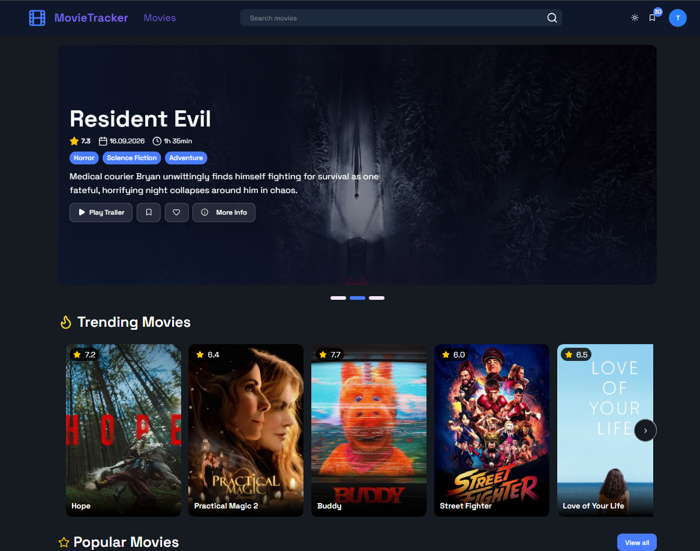
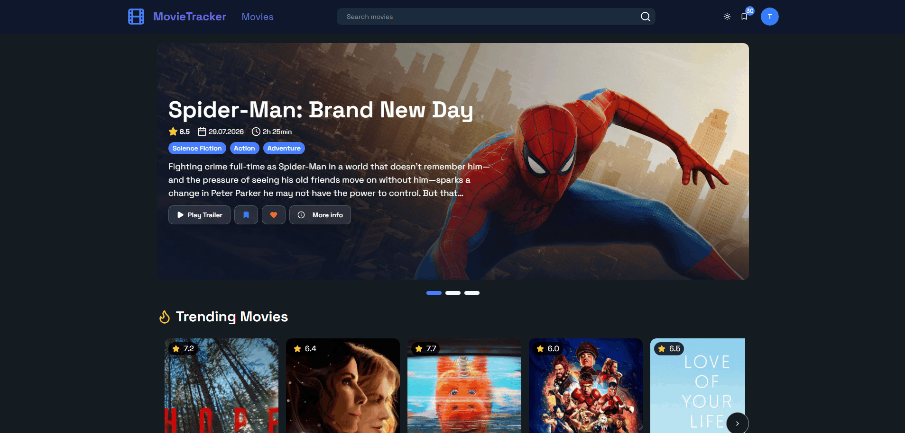
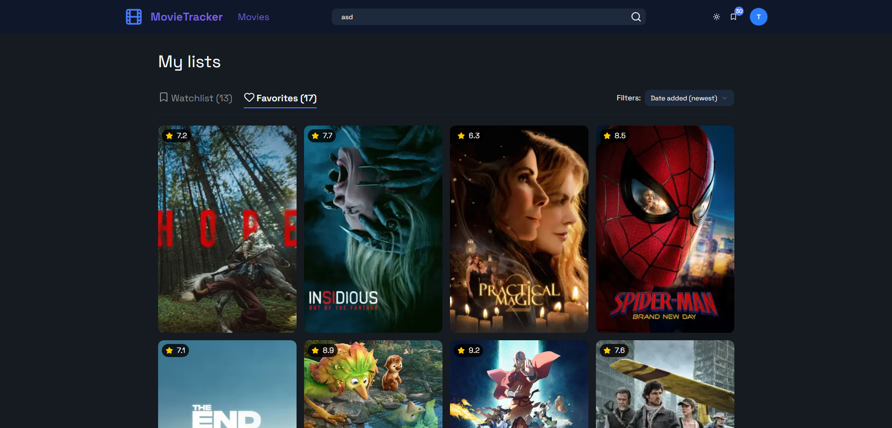
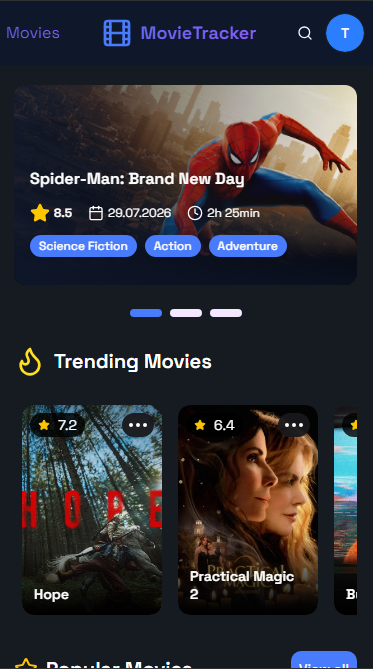
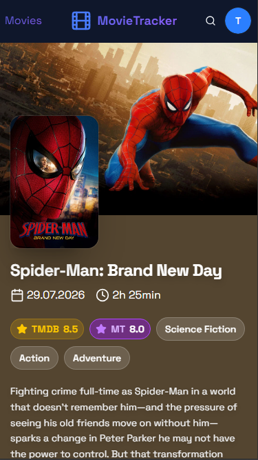

# Movie Tracker

A web app for tracking movies: browse popular and upcoming titles, rate what you've watched, write reviews, and keep your own lists. Movie data comes from [TMDB](https://www.themoviedb.org/).

**Live demo:** [MovieTracker](https://movie-tracker-tan.vercel.app/)





## Screenshots

<p align="center">
  
</p>

<p align="center">
  
  
</p>

## Features

- **Home page** with a hero carousel and Trending, Popular, Top Rated and Upcoming sections
- **Search** with live suggestions (debounced)
- **Movie page**: details, cast, trailer, similar movies and reviews
- **Dual rating system**: every movie shows both its TMDB rating and a separate community rating calculated from ratings given by Movie Tracker users, so you can compare the global score with what users of this app think
- **Merged reviews**: reviews fetched from TMDB and reviews written by Movie Tracker users are combined into a single review list on each movie page
- **My Ratings**: stats, a rating distribution chart, sorting and filtering, plus a badge showing how your rating differs from the average
- **My Lists**: watchlist and other lists with tabs and filters
- **Authentication** with email, GitHub and Google (Better Auth)
- **Settings**: change username and avatar color, manage active sessions
- **Import and export** of user data
- Responsive UI, loading skeletons, dark mode

## Tech stack

| Area                    | Technologies                                                  |
| ----------------------- | ------------------------------------------------------------- |
| Framework               | Next.js 16 (App Router, Server Actions), React 19, TypeScript |
| Styling                 | Tailwind CSS 4, shadcn/ui (Radix UI), lucide-react            |
| State and data fetching | TanStack Query, Zustand                                       |
| Forms and validation    | React Hook Form, Zod                                          |
| Database                | PostgreSQL (Neon), Drizzle ORM                                |
| Auth                    | Better Auth                                                   |
| Other                   | Recharts, Embla Carousel, Sonner                              |

## Getting started

### Prerequisites

- Node.js 20+
- pnpm
- A PostgreSQL database (e.g. a free [Neon](https://neon.tech/) project)
- A [TMDB API key](https://www.themoviedb.org/settings/api)

### Installation

```bash
git clone https://github.com/JakubBizon/movie-tracker.git
cd movie-tracker
pnpm install
```

### Environment variables

Create a `.env` file in the project root:

```env
DATABASE_URL=postgresql://...
API_KEY=your_tmdb_api_key
TMDB_TOKEN=your_tmdb_read_access_token

BETTER_AUTH_SECRET=random_secret
BETTER_AUTH_URL=http://localhost:3000

GITHUB_CLIENT_ID=
GITHUB_CLIENT_SECRET=
GOOGLE_CLIENT_ID=
GOOGLE_CLIENT_SECRET=
```

### Database and dev server

```bash
pnpm drizzle-kit migrate   # apply migrations
pnpm dev                   # http://localhost:3000
```

## Project structure

```
app/          # pages, API routes, server actions, DB schema and migrations
components/   # UI components grouped by page
hooks/        # custom React hooks
lib/          # TMDB queries, auth config, utilities
store/        # global state (Zustand)
```

> This product uses the TMDB API but is not endorsed or certified by TMDB.
