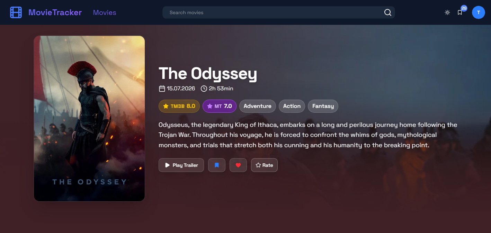

# Movie Tracker

A Next.js app for tracking movies. [TMDB](https://www.themoviedb.org/) supplies titles and metadata. Accounts, ratings, reviews, and lists are stored in Postgres, and each movie shows the TMDB score next to a community score from people using this app.

**Live demo:** [MovieTracker](https://movie-tracker-tan.vercel.app/)

Sign in with the shared demo account:

- **Email:** `demo@example.com`
- **Password:** `Movietrackerdemo1`

<p align="center">
  
</p>

## Features

- **Browse and search.** Hero carousel, Trending, Popular, Top Rated, and Upcoming, plus search with debounced suggestions. Loading skeletons and dark mode.
- **Movie page.** TMDB details, cast, and trailer, with this app's community score next to the TMDB score. Reviews from TMDB and reviews written here are one list.
- **My Ratings and lists.** A distribution chart, sorting and filtering, and a badge for how your score differs from the average. Watchlist and favorites have their own tabs.
- **Accounts and data.** Email, GitHub, and Google sign-in. The shared demo account can rate and manage lists, with profile and session changes locked. User data can be imported and exported.
- **Tests.** Vitest and Testing Library for components. Playwright for end-to-end flows against a local TMDB mock.

## Tech stack

| Area                     | Technologies                                                  |
| ------------------------ | ------------------------------------------------------------- |
| Framework                | Next.js 16 (App Router, Server Actions), React 19, TypeScript |
| Styling                  | Tailwind CSS 4, shadcn/ui (Radix UI), lucide-react            |
| State and data fetching  | TanStack Query, Zustand                                       |
| Forms and validation     | React Hook Form, Zod                                          |
| Database                 | PostgreSQL (Neon), Drizzle ORM                                |
| Auth                     | Better Auth                                                   |
| Unit and component tests | Vitest, Testing Library, jsdom                                |
| End-to-end tests         | Playwright                                                    |
| Other                    | Recharts, Embla Carousel, Sonner                              |

## Getting started

### Prerequisites

- Node.js 20+
- pnpm
- A PostgreSQL database (e.g. a free [Neon](https://neon.tech/) project)
- A [TMDB API key](https://www.themoviedb.org/settings/api)

### Installation

```bash
git clone https://github.com/JakubBizon/movie-tracker.git
cd movie-tracker
pnpm install
```

### Environment variables

Create a `.env` file in the project root:

```env
DATABASE_URL=postgresql://...
API_KEY=your_tmdb_api_key
TMDB_TOKEN=your_tmdb_read_access_token

BETTER_AUTH_SECRET=random_secret
BETTER_AUTH_URL=http://localhost:3000

GITHUB_CLIENT_ID=
GITHUB_CLIENT_SECRET=
GOOGLE_CLIENT_ID=
GOOGLE_CLIENT_SECRET=

# Email of the shared demo account. Leave empty to disable demo restrictions.
DEMO_USER_EMAIL=demo@example.com
```

### Database and dev server

```bash
pnpm drizzle-kit migrate   # apply migrations
pnpm dev                   # http://localhost:3000
```

## Demo account

`DEMO_USER_EMAIL` marks one existing user as the shared demo account. The email has to match a user already in the database. Anyone signed in as that user can still browse, rate, review, and manage lists, but a few account actions are blocked so the shared profile stays intact:

- username changes
- password changes, profile updates, and account deletion
- revoking sessions (including other sessions)

The settings page only lists the current browser's session and hides its IP address.

## Testing

### Vitest

Unit and component tests run in jsdom with Testing Library. Test files live next to the code they cover (`*.test.ts`, `*.test.tsx`). The `e2e/` folder is excluded.

```bash
pnpm test        # watch mode
pnpm test:run    # single run
```

### Playwright

End-to-end tests live in `e2e/`. They start the Next.js dev server, point TMDB requests at a local mock (`http://localhost:4010`), sign in a dedicated user (`e2e@example.com`), and then run the specs in Chromium, Firefox, and WebKit. Specs share that user and reset its ratings and favorites, so they run with one worker.

Playwright reads `.env.test` (same variables as `.env`). Use a separate database there. The suite writes and deletes rows for the e2e user.

```bash
pnpm exec playwright install   # browsers, first time only
pnpm test:e2e                  # headless
pnpm test:e2e:ui               # Playwright UI
```

## Project structure

```
app/          # pages, API routes, server actions, DB schema and migrations
components/   # UI components grouped by page
e2e/          # Playwright specs, auth setup, and the TMDB mock
hooks/        # custom React hooks
lib/          # TMDB queries, auth config, utilities
store/        # global state (Zustand)
```

> This product uses the TMDB API but is not endorsed or certified by TMDB.
